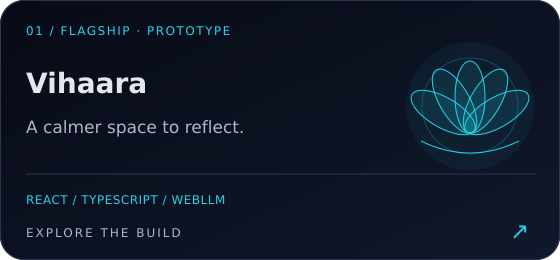
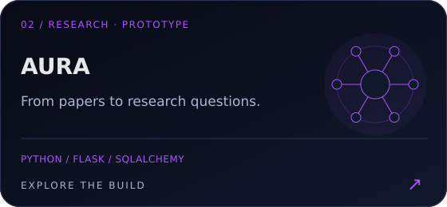
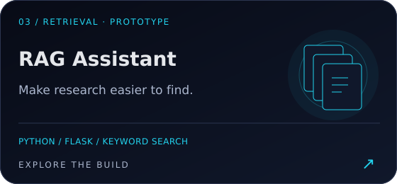
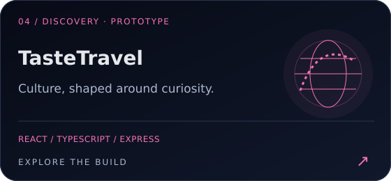
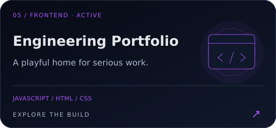
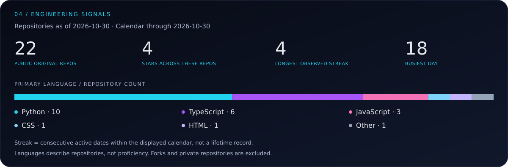
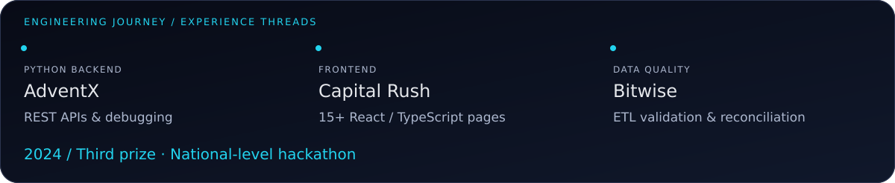

  

  <a href="https://portfolio-one-alpha-13.vercel.app/">Portfolio</a> &nbsp; / &nbsp;
  <a href="https://www.linkedin.com/in/aishwaryachandel/">LinkedIn</a> &nbsp; / &nbsp;
  <a href="mailto:aishwaryachandel27@gmail.com">Email me</a> &nbsp; / &nbsp;
  <a href="https://github.com/AishwaryaChandel27?tab=repositories">Explore my code</a>

# Useful intelligence. Thoughtfully built.

I'm **Aishwarya**, a developer in India working across **Python, AI applications, full stack development, and data quality**. I turn ideas into practical tools: a calmer wellness companion, a research assistant, a cultural travel planner, and interfaces that make complex systems easier to use.

**Open to junior engineering opportunities, focused freelance projects, and open-source collaboration.**

  

[Featured builds](#01--selected-builds) · [Technical ecosystem](#02--technical-ecosystem) · [Contribution city](#03--contribution-metropolis) · [Collaborate](#06--lets-build-something-useful)

<strong>Boot developer.os</strong> — how I approach the work

 

**My approach:** understand the problem, build a usable path through it, validate the details, and be clear about what the system can and cannot do.

## 01 / Selected builds

Five projects, five engineering questions. **Prototype** means an implemented exploration whose production readiness has not been established. The artwork below is original concept illustration, not product screenshots.

### Vihaara · Flagship / Prototype

**How can an AI experience feel calm and keep inference on the user's device?**

A local-first wellness companion with journaling, mood check-ins, breathing exercises, and synthesized ambient sound. Optional WebLLM inference runs in a Web Worker; the prepared offline guide remains available when the model cannot run.

**Built with:** React · TypeScript · Vite · Tailwind · WebLLM · Web Audio 
**Engineering focus:** model loading, cancellation, device compatibility, and browser data recovery. 
**Boundary:** wellbeing prototype; not clinically validated. On-device AI needs WebGPU and an initial model download.

[Explore source →](https://github.com/AishwaryaChandel27/Vihaara--AI-powered-mental-wellness-and-healthcare-app) · [Architecture & validation →](https://github.com/AishwaryaChandel27/Vihaara--AI-powered-mental-wellness-and-healthcare-app/blob/main/docs/VALIDATION.md)

---

### AURA · Research / Prototype

**How do you coordinate retrieval, summarization, and hypothesis generation?**

A research application with separate agent modules for academic paper retrieval, summaries, hypotheses, and experiment design. The controller coordinates services for arXiv, Semantic Scholar, and model-backed responses.

**Built with:** Python · Flask · SQLAlchemy · OpenAI integration 
**Engineering focus:** separating orchestration, provider integrations, and research workflows. 
**Boundary:** experimental research assistance; generated hypotheses need human evaluation. Some features require provider credentials.

[Explore source →](https://github.com/AishwaryaChandel27/AURA) · [Agent controller →](https://github.com/AishwaryaChandel27/AURA/blob/main/agents/agent_controller.py)

---

### RAG-powered Assistant · Retrieval / Prototype

**How do you make a publication collection searchable and its answers inspectable?**

A publication search application that retrieves documents and formats answers from the matching source material. Its active pipeline uses `SimpleSearchEngine`; a separate FAISS/OpenAI vector-store implementation explores embedding-based retrieval.

**Built with:** Python · Flask · SQLAlchemy · keyword retrieval 
**Engineering focus:** document preparation, ranked retrieval, source metadata, and query history. 
**Boundary:** the current answer path formats retrieved text; it does not generate answers with an LLM. The vector module is not the active default pipeline.

[Explore source →](https://github.com/AishwaryaChandel27/RAG-powered-assistant) · [Active pipeline →](https://github.com/AishwaryaChandel27/RAG-powered-assistant/blob/main/rag_pipeline.py)

---

### TasteTravel · Discovery / Prototype

**How do personal preferences become a useful cultural travel plan?**

A travel-planning interface with cultural preferences, destination exploration, itinerary building, and AI-provider integrations. A unified service attempts an alternative provider when the primary provider fails.

**Built with:** React · TypeScript · Express · Tailwind · TanStack Query 
**Engineering focus:** connecting preference-driven interfaces to a provider fallback service. 
**Boundary:** AI features depend on configured third-party services; live recommendation accuracy and production readiness are not established.

[Explore source →](https://github.com/AishwaryaChandel27/TasteTravel---Personalized-Cultural-Travel-Planner) · [Provider orchestration →](https://github.com/AishwaryaChandel27/TasteTravel---Personalized-Cultural-Travel-Planner/blob/main/server/services/ai-service.ts)

---

### Engineering Portfolio · Frontend / Active

**How can a portfolio be playful, accessible, and simple to deploy?**

A static portfolio with original bot mascots, project filters, case-study dialogs, and interactive concept demonstrations. Motion controls and reduced-motion support make animation optional.

**Built with:** JavaScript · HTML · CSS · SVG · Node.js build validation 
**Engineering focus:** expressive interfaces without a framework dependency, plus checks for deployment paths and assets. 
**Boundary:** sample business demos are explicitly fictional; the contact form prepares an email draft. The linked public portfolio in the header is a separate, verified older deployment.

[Explore source →](https://github.com/AishwaryaChandel27/aishwarya-engineering-portfolio)

## 02 / Technical ecosystem

| Area | Technologies and practices | Where the evidence comes from |
| :--- | :--- | :--- |
| **AI & intelligent systems** | Python automation, retrieval pipelines, WebLLM, model-provider integrations | Personal projects; RAG experiments distinguish keyword and vector paths |
| **Frontend engineering** | React, TypeScript, JavaScript, HTML, CSS, Tailwind | Vihaara, TasteTravel, portfolio; frontend internship work |
| **Backend & integrations** | Python, Flask, Express, REST APIs, SQLAlchemy; Postman | Python backend experience and application repositories |
| **Data engineering & quality** | SQL, IBM DataStage, ETL testing, data validation, source-to-target reconciliation | Data / ETL work at Bitwise |
| **Tools & deployment** | Git, GitHub, Vite, Vercel configuration | Project source, build scripts, and deployment configuration |
| **Continuing learning** | Snowflake coursework; deeper data engineering and retrieval evaluation | Learning focus, not a claim of production expertise |

## 03 / Contribution metropolis

**One day. One block. Real activity.** Building height uses a logarithmic scale so unusually busy days do not obscure the rest of the calendar. Roof colors show count bands; the busiest dates receive a tower beacon.

The snapshot includes the dates shown in the image. GitHub-visible activity may include anonymized private contributions when enabled; it is not a public-commit count or a measure of engineering quality. Daily refreshes preserve the last successful result when GitHub is unavailable.

[Inspect the source data](./data/contributions.json) · [Read the generator](./scripts/generate_city.py) · [Automation & setup](./docs/SETUP.md)

<strong>Bonus: contribution snake</strong>

<!-- SNAKE:START -->
The optional snake workflow generates its animation from GitHub activity and adds it here after its first successful run. [Workflow source](./.github/workflows/contribution-snake.yml).
<!-- SNAKE:END -->

The city remains the main activity visualization. Expand this section only when you want the extra animation.

## 04 / Engineering signals

[Inspect the repository snapshot](./data/repositories.json) · [GitHub activity & achievements](https://github.com/AishwaryaChandel27?tab=overview)

The streak is measured **within the displayed calendar**, not across the account's lifetime. Language shares count each repository's primary language; they do not measure proficiency. GitHub's native profile is the source for achievements; no unofficial trophy service is used.

## 05 / Experience, curiosity, and craft

- **Bitwise — Data / ETL quality:** SQL validation, reconciliation, and pipeline data checks.
- **AdventX — Python backend:** backend functionality, REST APIs, and debugging.
- **Capital Rush — Frontend:** contributed to more than 15 React/TypeScript pages.
- **2024 — National-level hackathon:** third prize.

These are experience threads, not a dated employment sequence. Dates are included only where confirmed.

**Beyond the code:** I enjoy creative application design, meaningful AI systems, and the small interface decisions that help people feel comfortable using technology. My best project ideas begin with a real problem and a question worth exploring.

## 06 / Let's build something useful

**For founders and freelance clients:** Python automation, API integration, React interfaces, and scoped AI prototypes. 
**For engineering teams:** junior opportunities across Python, full stack development, data quality, and applied AI. 
**For open-source maintainers:** practical issues where careful implementation and documentation can help.

Send me the problem, the expected outcome, and your timeline.

**[aishwaryachandel27@gmail.com](mailto:aishwaryachandel27@gmail.com)** 
[LinkedIn](https://www.linkedin.com/in/aishwaryachandel/) · [Portfolio](https://portfolio-one-alpha-13.vercel.app/) · [GitHub](https://github.com/AishwaryaChandel27)

---

Original SVG identity · Actual activity data · Built to stay maintainable. [How this profile works](./docs/SETUP.md)
