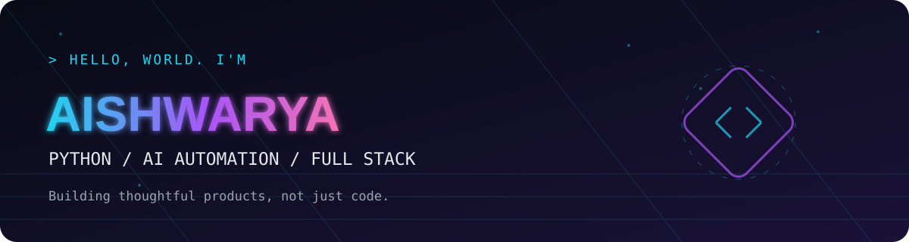
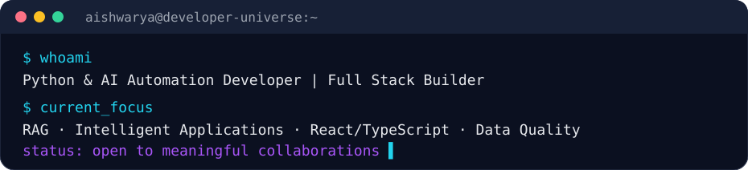
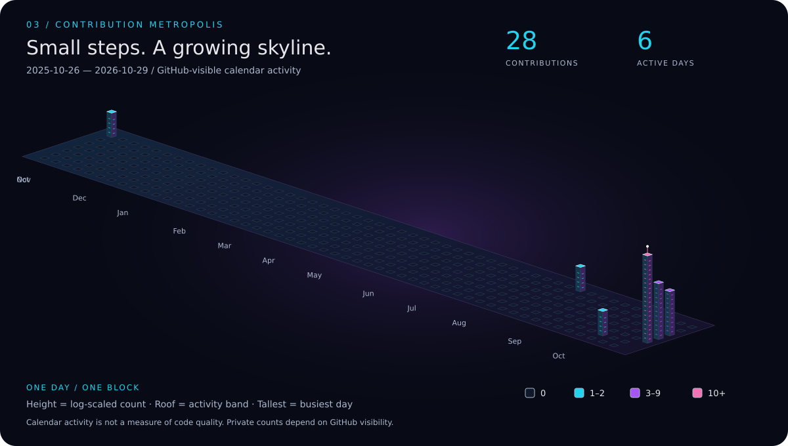

  
    
  
  
  
  

 

### ✨ What I build

I build **practical AI-powered applications, Python automations, and thoughtful web interfaces**. My work connects backend systems, intelligent retrieval, data validation, and user-centered design. I enjoy turning ideas into usable products—from wellness tools to cultural travel experiences.

- **AI + automation:** Retrieval-augmented generation, Python services, intelligent workflows.
- **Full stack:** React, TypeScript, JavaScript, Flask, REST APIs.
- **Data quality:** SQL, ETL validation, source-to-target reconciliation.
- **Open to:** Selected freelance projects, open-source collaborations, and junior engineering opportunities.

---

## 🚀 Featured builds

| Project | Why it matters | Explore |
|:--|:--|:--|
| 🌿 **Vihaara** | AI-powered mental wellness and healthcare application; a product-focused exploration of supportive digital experiences. | [View repository](https://github.com/AishwaryaChandel27/Vihaara--AI-powered-mental-wellness-and-healthcare-app) |
| 🧠 **RAG-powered Assistant** | Document-aware assistant exploring retrieval and grounded question answering. | [View repository](https://github.com/AishwaryaChandel27/RAG-powered-assistant) |
| ✈️ **TasteTravel** | Personalized cultural travel planner bringing discovery and technology together. | [View repository](https://github.com/AishwaryaChandel27/TasteTravel---Personalized-Cultural-Travel-Planner) |
| ⚡ **AURA** | Experimentation with intelligent application concepts and AI workflows. | [View repository](https://github.com/AishwaryaChandel27/AURA) |
| 🎨 **Engineering Portfolio** | An interactive showcase of frontend craft and software projects. | [View repository](https://github.com/AishwaryaChandel27/aishwarya-engineering-portfolio) |
| 🏹 **Archery Precision Posture Evaluation** | A computer-vision-oriented project for movement and posture evaluation. | [View repository](https://github.com/AishwaryaChandel27/Archery-Precision-Posture-Evaluation) |

> Explore individual repositories for implementation details and current project status. Not every project is a deployed production application.

---

## 🧩 My engineering toolkit

**AI & Automation**  
  

**Frontend & Backend**  
    

**Data & Tools**  
    

---

## 🌃 Contribution City

*An isometric skyline generated from actual GitHub contribution-calendar activity. Taller buildings represent more contributions on a given day.*

  

The city is regenerated by GitHub Actions once per day. It shows calendar contributions; it is not a measurement of code quality or impact. GitHub private-contribution visibility depends on your account settings and API permissions.

---

## 📊 Activity signals

  

---

## 🛠️ Where I've applied these skills

- **Data / ETL Quality — Bitwise:** SQL validations, data reconciliation, pipeline quality checks.
- **Python Backend — AdventX:** Backend functionality, REST APIs, debugging.
- **Frontend — Capital Rush:** Contributed to more than 15 React/TypeScript pages.
- **Hackathon:** Third prize at a national-level hackathon in 2024.

---

## 🤝 Let's build something useful

Have a well-scoped Python automation, API integration, React interface, or an AI prototype to explore? I'd love to hear about it.

**[Email me](mailto:aishwaryachandel27@gmail.com)** · **[LinkedIn](https://www.linkedin.com/in/aishwaryachandel/)** · **[Portfolio](https://portfolio-one-alpha-13.vercel.app/)**

Made with curiosity, careful engineering, and a little neon. ✦

